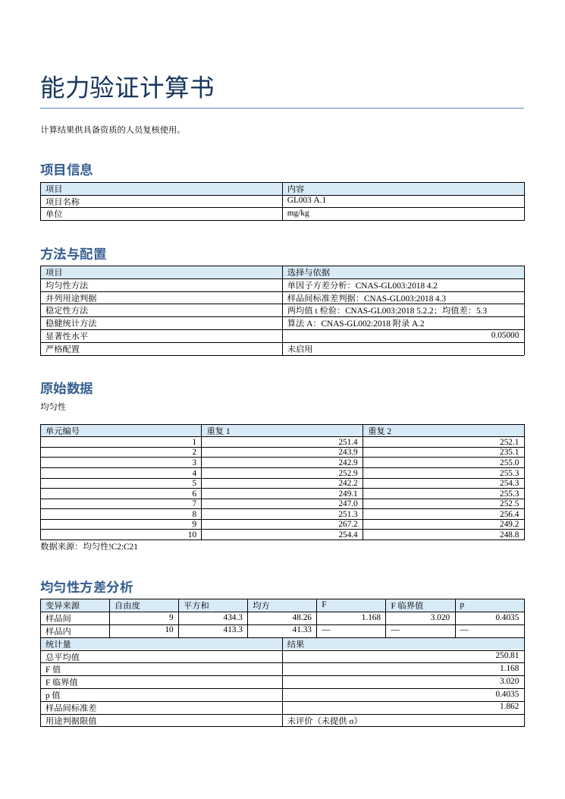

# OpenPT 0.2.0.dev1（封闭内测，未公开发布）

能力验证统计工作台原型，提供单因子 ANOVA、Ss、稳定性 t 检验、算法 A 和 S、中位数与 NIQR、指定值及不确定度、D、D%、z、z′、ζ、En、Excel 模板、复核差异表与 DOCX。计算结果供具备资质的人员复核使用；方法依据为 CNAS-GL003:2018、CNAS-GL002:2018，用户可配置。**当前尚未通过全部验收，不得用于正式评价或直接发布。**

## 安装

Windows（Python 3.10～3.13）：

```powershell
py -m pip install -i https://pypi.tuna.tsinghua.edu.cn/simple -e ".[test]"
```

若 Python 的 `Scripts` 目录不在 PATH，使用 `py -m openpt demo 演示目录`、
`py -m openpt run input.xlsx` 等命令。可选 Wine 测试及其局限见
[Windows 兼容性测试](docs/Windows兼容性测试.md)。

Linux（用于开发和持续集成，不提供 macOS 支持承诺）：

```sh
python -m pip install -i https://pypi.tuna.tsinghua.edu.cn/simple -e '.[test]'
```

需要可选库交叉核对时单独安装 `.[crosscheck]`。`requirements.lock` 仅记录开发机 Python 3.12 的一次解析；跨平台使用项目声明的版本范围。实际运行平台和完整许可证必须审查，见 `THIRD_PARTY_LICENSES.md`。

## 快速开始

```text
openpt template input.xlsx
openpt run input.xlsx
openpt review input.xlsx --mapping examples/mapping.json
openpt review-batch input1.xlsx input2.xlsx --output differences.xlsx --mapping examples/mapping.json
openpt demo demo-output
openpt --version
python -m pytest -m "not internal"
```

默认结果写在输入文件旁；`--docx`、`--json` 和 `--differences` 可覆盖路径。`demo` 生成公开示例，检测到 LibreOffice 时额外转换 PDF。



填入项目名称、统一单位和均匀性表，每个包装单元每次重复一行；支持平衡及不平衡重复，不平衡属于待审核扩展方法。稳定性表的时间组使用 `基线` 和 `稳定期`。参考输入 `examples/GL003_A1.xlsx`。所有输入必须是实际值，不接受公式。复核声称值需填写统计量、数值、显示小数位及来源。报告模型可填 `recommended`、`repeats_pooled`、`repeats_welch`、`displayed_summary`。最后一种还需在配置表输入 `mean1`、`mean2`、`s1`、`s2`、`n1`、`n2`；多时点复核需在声称值表的“时间组”列指定时点。评分映射通过 `--mapping` 加载。差异清单按 `DIFFERENCE`、`NOTE`、`MATCH` 分组排序；报告模型能复现时，推荐模型不同只记为提示，不直接认定报告错误。`REPORT_RULE_UNKNOWN` 表示绝对容差仅作候选，原报告停止规则尚待确认；`STOP_RULE_SENSITIVITY` 表示停止规则影响显示结果。无更具体类别的提示使用 `REVIEW_NOTE`，待核查差异使用 `REVIEW_REQUIRED`。

## 候选批次

新模板的“候选批次”表可登记候选、失败、选用和弃用状态；失败或弃用须填理由，关联批次必须存在。预实验结果可填写英文逗号分隔的有限数，计算书列出均值与样本标准差（单个结果无法计算标准差）。选择由人员登记，软件不自动选择或放行。旧模板可以继续使用。

## 实验性只读导入检查

`openpt validate input.xlsx [--columns columns.json]` 只读检查已有的均匀性、稳定性和参加者测量表，输出 JSON 问题列表。列映射 JSON 格式示例：`{"均匀性": {"单元编号": "样品", "值": "读数"}}`，即标准字段映射到原表头；未列出的字段使用标准表头。CSV 用 `openpt validate input.csv --sheet 均匀性 --encoding utf-8-sig` 检查；GBK 文件须显式指定 `--encoding gbk`。有问题返回码为 1，输入错误返回码为 2。

这是独立的预检查，不会修改输入、不会创建快照。`run`/`review` 也支持 `--columns columns.json`，或用 `--unit mg --encoding utf-8-sig --csv-sheet 均匀性` 导入单测量表 CSV。CSV 的工作表名是所选类型，列号和行号对应原文件；项目名称可通过 `--project` 指定。检查范围限上述测量表；单位与项目单位比较，未登记项目单位时比较首个非空单位。当前模板只支持项目统一单位，不能表达多测量对象的不同单位，也不检查其他工作表或补全缺失工作表。公式即使有缓存，现有计算器仍不接受；原始输入和列映射会保存到运行快照。

## 随机抽样

`openpt sample --units 100 --pick 20 --seed 42 --output sample-output` 创建新目录，输出 JSON、CSV 和 XLSX；默认每单元生成两次重复的随机检测顺序。可通过 `--strata strata.json` 指定完整分层，例如 `{"层A": [1, 2], "层B": [3, 4]}`（须覆盖 1 至总体数且不得重复）。抽样数不足 10 时提示 `DESIGN_WARNING`；重复测试实际独立取样仍须由人员保证。JSON 保留完整映射和种子，因此盲码不构成身份保密措施；CSV 的危险开头层名会加单引号防公式注入，原始层名保存在 JSON。可用 `run`/`review --sample-record` 把抽样 JSON 作为原始输入一并快照，算法细节见 ADR-003。

## 可追溯工作流

`openpt run input.xlsx --runs-dir runs` 或 `openpt review input.xlsx --runs-dir runs` 会创建新的运行目录，保存原始输入字节、配置、环境、结果、DOCX、日志及哈希清单；默认运行目录根为当前目录的 `runs/`。`--sample-record sample-output/sample.json` 可附带抽样记录。为兼容旧接口，计算书和 JSON 同时仍写入输入文件旁或指定输出位置，普通输出不能写进已有运行目录。

`openpt reproduce 运行目录` 首先核验清单，再重新计算并逐字段比较；环境不同会警告。`openpt pack 运行目录 -o 新文件.zip` 打包，`openpt verify 新文件.zip` 检查清单；不解压或执行包内代码，也不覆盖已有 ZIP。清单格式为 `{"files": {"相对文件名": "小写 SHA-256"}}`，清单本身不列入 `files`。清单没有数字签名，攻击者同时修改清单与内容时无法验证真实性；应通过可信渠道独立保存 ZIP 哈希或使用外部签名。每次运行同时生成 DOCX、XLSX 和内联样式 HTML。`openpt decide 运行目录 --item 均匀性 --decision 接受 --by 复核人 --note 备注` 会追加决定并生成新的带序号计算书，不改原始输入和旧计算书；这是运行目录追加写入的明确例外。决定追加后会更新清单，若中途失败导致清单不一致须人工恢复。软件不自动放行。虚构演示可执行 `python examples/trace_workflow.py 新目录`；`examples/trace_run/` 为一份已生成的样例。

## 配置与边界

各统计判据比较统一采用相对容差 `1e-12`，容差内视为相等；原始计算值不修约。真实差异若落入容差范围也会视为边界，须人工复核；具体比较及严格不等式处理见 ADR-002。

方法配置表 `alpha` 默认 0.05；`sigma` 缺省时相应提示未评价；`strict_homogeneity` 默认 FALSE；`stability_method` 默认 `two_sample`，可设 `one_sample` 并提供 `reference`；`assigned` 和 `sigma_pt` 用于 z；未提供 `sigma_pt` 时回退到 `sigma`。稳定性推荐模型使用包装单元均值。算法 A 的 `algorithm_a_rule` 默认 `gl002`（第三有效位及对应位），可选 `absolute`（使用 `algorithm_a_tolerance`）或 `simplified`；可配置 `algorithm_a_max_iterations`。程序另算绝对容差收敛对照并放入计算书附录，显示位数不同时提示停止规则敏感。DOCX 参加者 z 值默认保留两位小数，配置 `display_z_decimals` 可设 0～12 位；CSV 和 JSON 不按此设置截断。不平衡均匀性方法及分位数定义见 ADR-002。相关和配对稳定性设计必须在模板中显式声明，程序将阻断结论；参考值不确定度不可忽略时亦须显式声明并阻断。程序不能自动判定设计独立性。全部重复值仅用于复核，常规运行不接受。GL003 之外的扩展配置尚未实现。

### 指定值和能力统计量

在“指定值与不确定度”表登记方法：`known`、`certified`、`reference`、`expert_consensus`、`participant_consensus`。前四类可输入已评定的值、标准不确定度及各自来源；已知值也可在 `known_components` 中以英文逗号分隔输入互相独立的标准不确定度分量，按平方和开方合成；专家公议也可在 `expert_values` 中输入独立同精度的专家结果，使用算术平均值和样本标准误 s/√n，这些为须事先批准的扩展方法。参加者公议值选择 `robust_mean` 或 `median`，使用扩展方法 u(X)=1.25s*/√p。该公式见 GB/T 28043-2019 7.7.3 式(6)，其对中位数法的具体适用性须专家批准。临时和最终 σ_pt 及确定程序分开登记，最终值优先；没有最终值时计算结果提示临时值。`hom_mapping`、`stab_mapping` 可为 `none`、`assigned`、`sigma_prime`；`both` 和重复计入会触发 `DESIGN_REVIEW` 并阻止参加者评价。基础 u(X) 已含某分量时须如实设置相应 `*_in_base`。程序假定已选分量独立，无法识别未登记的重复计入。

方法配置的 `score_type` 可选 `D`、`D%`、`z`、`zprime`、`zeta`、`En` 或 `all`。参加者表中的 u(x)、U(x)、k 用于 ζ 和 En；指定值表需登记 `U_assigned`、`k_assigned` 及结果间 `independent`。En 按 GL002 使用 k=2；ζ 和 En 仅适用于不相关结果。缺少前提时不作评价。指定值由参加者公议时 z′ 转设计审核。D 和 D% 没有默认满意度判据。`examples/assigned_value_scores.xlsx`、`.json`、`.docx` 均为虚构数据。

“算法S”表填写至少两个标准差或极差和统一自由度 1～10，可获得 GL002 A.3 算法 S 结果及迭代历史。`algorithm_s_stop_rule` 可选 `gl002` 或 `absolute`，后者使用 `algorithm_s_tolerance`；程序另算绝对和相对变化量均不超过 1e-12 的收敛对照，三位有效数字不同则提示 `STOP_RULE_SENSITIVITY`。复核声称值支持 `NIQR`、`u(X)`、`zprime:参加者编号`、`zeta:参加者编号`、`En:参加者编号`；映射 JSON 可将统计量键映射到多个条目字符串组成的数组。批量输出按 `DIFFERENCE`、`NOTE`、`MATCH` 排序并支持筛选。

DOCX 指定中文宋体、西文 Times New Roman，不附带字体；若系统缺字，请安装有授权的相应字体或在文档编辑器中选择已安装的中文字体后重新导出。不同平台排版需逐页检查。

公开仓库不包含历史项目数据；内部材料必须保存在仓库外，设置 `OPENPT_INTERNAL_DIR` 后才运行标记为 internal 的测试。仅将已授权的材料存入该目录。

## 引用与许可

引用软件请参见 `CITATION.cff`。项目代码采用 Apache-2.0，详见 `LICENSE` 和 `NOTICE`；第三方许可及原生运行库限制见 `THIRD_PARTY_LICENSES.md`。
